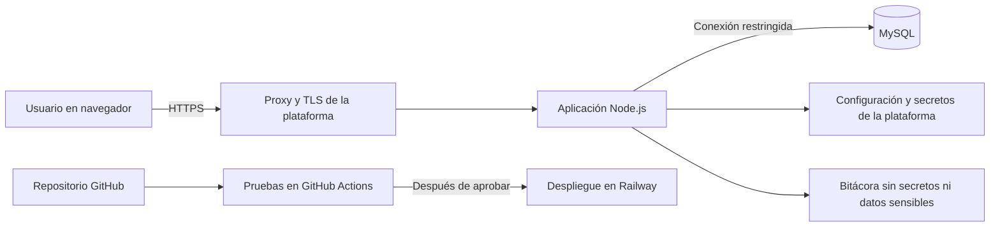

# Arquitectura y modelo de amenazas

Documento de diseño de la práctica. **Estado: propuesta; las medidas y pruebas
quedan pendientes hasta verificarse en el código y en el despliegue real.** No
describe la arquitectura ni el estado de seguridad de Vértice CR.

## Alcance y límites de confianza

La aplicación permite administrar notas privadas y un dato sensible de perfil.
El backend comprueba identidad y permisos; una persona administradora consulta
usuarios y eventos de seguridad. Las contraseñas se verifican mediante hash y
el contenido recuperable se protege mediante cifrado autenticado. La base de
datos y el proveedor de despliegue constituyen límites de confianza distintos.

El dibujo representa el flujo previsto. Antes de entrega se debe verificar la
cadena real de proxies, la protección del tráfico hacia MySQL, el método
de entrega de tokens de recuperación y que el despliegue espere a CI. HTTPS del
navegador al proxy no demuestra por sí solo el cifrado de otros tramos.

## Datos y flujo de autenticación

Modelo conceptual sujeto a revisión contra la implementación:

| Datos | Propósito | Protección prevista |
| --- | --- | --- |
| Usuario | Identificación, hash de contraseña y rol | Correo único; hash lento con sal; rol validado en servidor |
| Nota | Contenido privado y propietario | Consultas por usuario autenticado; cifrado autenticado |
| Perfil | Dato sensible del propietario | Cifrado autenticado y visualización enmascarada |
| Sesión o credencial de acceso | Mantener autenticación entre solicitudes | Caducidad e invalidación; cookie segura si se usan sesiones |
| Recuperación | Autorizar un cambio de contraseña | Token aleatorio temporal de un solo uso; solo su hash en base de datos |
| Evento de seguridad | Auditar acciones relevantes | Registrar acción, resultado y contexto mínimo, sin secretos |

1. El servidor valida los datos de registro y conserva un hash, nunca la
   contraseña recuperable.
2. Al iniciar sesión verifica la contraseña; si se usa una sesión, renueva su
   identificador y configura una cookie `HttpOnly`, `Secure` en HTTPS y
   `SameSite` apropiado.
3. Cada operación verifica nuevamente la sesión, el rol y la propiedad del
   recurso en el servidor; los controles visuales no sustituyen autorización.
4. El cierre invalida la sesión. La recuperación requiere un canal de entrega
   seguro, token aleatorio con caducidad y un único uso, e invalida las sesiones
   según la política definida. No se publica el token en la interfaz ni logs.

## STRIDE: amenazas, controles y comprobación

Cada control y comprobación de esta tabla es **propuesto, pendiente de verificar**.
El impacto depende del uso real y no es una calificación certificada.

| Amenaza | Escenario | Control previsto | Evidencia requerida |
| --- | --- | --- | --- |
| Suplantación | Contraseña reutilizada o fuerza bruta | Hash Argon2id, bloqueo progresivo y sesión con rotación | Reintentos rechazados con 429; prueba de renovación y cierre |
| Manipulación | Alteración de nota cifrada o solicitud maliciosa | AES-256-GCM, validación y consultas parametrizadas | Cambiar el ciphertext y observar fallo controlado; inyección neutralizada |
| Repudio | Administrador cambia un rol y niega la acción | Bitácora de cambios y accesos denegados | Evento verificable sin secretos ni datos privados |
| Divulgación | Usuario A solicita una nota de B o extrae un respaldo | Consultas por propietario, cifrado y llaves separadas | Lectura, modificación y eliminación cruzadas rechazadas; datos cifrados en BD |
| Denegación de servicio | Intentos masivos o contenido excesivo | Límites de petición, intentos y tamaño/cantidad de notas; timeouts | Pruebas de límites, 429 y recuperación del proceso |
| Elevación de privilegios | Usuario modifica una solicitud para hacerse administrador | Rol verificado en servidor y denegación por defecto | Acceso directo a rutas administrativas rechazado |

## Cuestiones por cerrar

- Comprobar las variables y arquitectura implementadas y su configuración real.
- Definir y verificar entrega privada del token de recuperación y las
  credenciales de demostración; no incluirlas en Git, informe, pantalla o logs.
- Confirmar límites reales del plan de Railway, disponibilidad durante la
  evaluación, copias y prueba de restauración.
- Identificar riesgos residuales y responsables, y actualizar esta tabla con
  resultados observados en lugar de marcar controles como ejecutados por defecto.
